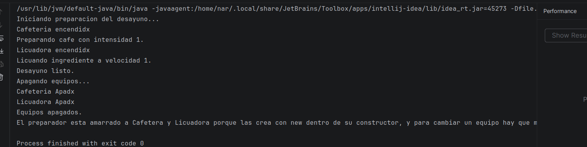
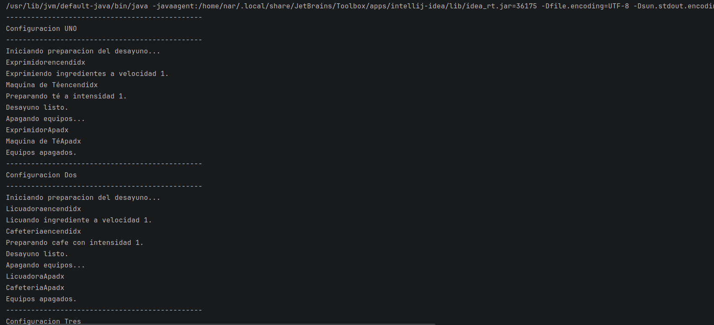
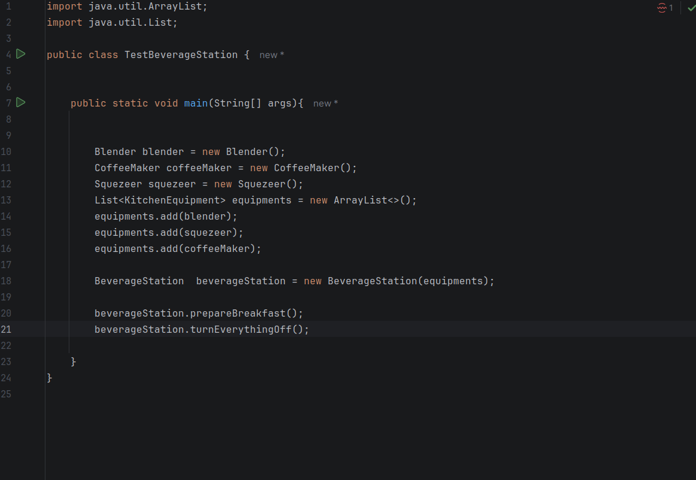
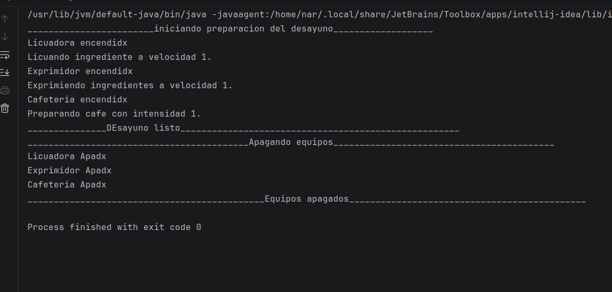

# Laboratorio: Interfaces e Inyeccion de Dependencias (Cafeteria en problemas)

Refactorizacion de un sistema de preparacion de bebidas para eliminar el acoplamiento a clases concretas, usando una interfaz como contrato e inyeccion de dependencias por constructor.

## Contenido

1. [Problema original](#problema-original)
2. [Solucion](#solucion)
3. [Estructura del proyecto](#estructura-del-proyecto)
4. [Equivalencia de nombres](#equivalencia-de-nombres)
5. [Extra: clase abstracta BaseEquipment](#extra-clase-abstracta-baseequipment)
6. [Pruebas y evidencias](#pruebas-y-evidencias)
7. [Como ejecutar](#como-ejecutar)

## Problema original

El preparador de bebidas creaba sus propios equipos con `new Cafetera()` y `new Licuadora()` dentro del constructor. Esto lo dejaba amarrado a clases concretas: para cambiar de marca, agregar una maquina de te o reemplazar la licuadora habia que modificar el codigo del preparador. Ademas, siempre estaba obligado a trabajar con exactamente esos dos equipos.

## Solucion

- **Interfaz `KitchenEquipment`:** define el contrato que todo equipo debe cumplir (`turnOn`, `turnOff`, `prepare`, `adjustIntensity`).
- **Equipos concretos:** `CoffeeMaker`, `Blender`, `TeaMachine` y `Squezeer` implementan la interfaz, cada uno con su propio comportamiento.
- **Inyeccion por constructor:** `BeverageMaker` recibe dos `KitchenEquipment` desde afuera y no conoce ninguna clase concreta.
- **Segunda version:** `BeverageStation` recibe una `List<KitchenEquipment>`, por lo que permite usar cualquier cantidad y combinacion de equipos (incluso uno solo).

## Estructura del proyecto

```
src/
  KitchenEquipment.java    Interfaz (contrato)
  BaseEquipment.java       Clase abstracta con logica comun (extra)
  CoffeeMaker.java         Equipo: cafetera
  Blender.java             Equipo: licuadora
  TeaMachine.java          Equipo: maquina de te
  Squezeer.java            Equipo: exprimidor
  BeverageMaker.java       Preparador con dos equipos inyectados
  BeverageStation.java     Preparador con lista de equipos
  TestAnalysis.java        Parte 1: analisis del problema
  TestBeverageMaker.java   Parte 6: tres configuraciones
  TestBeverageStation.java Parte 7: prueba con lista de equipos
  Main.java
```

## Equivalencia de nombres

Los nombres de las clases estan en ingles. La salida por consola se mantiene en espanol.

| Nombre en el enunciado     | Nombre en este proyecto   |
|----------------------------|---------------------------|
| `EquipoCocina`             | `KitchenEquipment`        |
| `Cafetera`                 | `CoffeeMaker`             |
| `Licuadora`                | `Blender`                 |
| `MaquinaTe`                | `TeaMachine`              |
| `Exprimidor`               | `Squezeer`                |
| `PreparadorBebidas`        | `BeverageMaker`           |
| `PreparadorBebidasV2`      | `BeverageStation`         |
| `TestAnalisis`             | `TestAnalysis`            |
| `TestPreparadorBebidas`    | `TestBeverageMaker`       |
| `TestPreparadorBebidasV2`  | `TestBeverageStation`     |

| Metodo en el enunciado | Metodo en este proyecto |
|------------------------|-------------------------|
| `encender()`           | `turnOn()`              |
| `apagar()`             | `turnOff()`             |
| `preparar()`           | `prepare()`             |
| `ajustarIntensidad()`  | `adjustIntensity()`     |
| `prepararDesayuno()`   | `prepareBreakfast()`    |
| `apagarTodo()`         | `turnEverythingOff()`   |

## Extra: clase abstracta BaseEquipment

Esta clase **no fue solicitada en el laboratorio**; se agrego como mejora para evitar codigo repetido.

Todos los equipos repetian los mismos atributos (`on` e `intensity`) y la misma logica para encender, apagar y ajustar la intensidad. `BaseEquipment` centraliza esa parte comun:

- Implementa la interfaz `KitchenEquipment`.
- Guarda los atributos compartidos `on` e `intensity`.
- Implementa `turnOn()`, `turnOff()` y `adjustIntensity()`.
- Deja `prepare()` sin implementar, porque es lo unico que cambia en cada equipo.
- Cada clase hija solo escribe su propio `prepare()` y lo que sea especifico de ella.

La interfaz se mantiene como el contrato principal: `BeverageMaker` y `BeverageStation` dependen de `KitchenEquipment`, no de `BaseEquipment`. La clase abstracta es un detalle interno de implementacion, de modo que un equipo podria cumplir el contrato sin heredar de ella.

## Pruebas y evidencias

### Parte 1: Analisis del problema (`TestAnalysis`)



### Parte 6: Flexibilidad del diseno (`TestBeverageMaker`)

Se prueban tres configuraciones del mismo preparador, sin modificar su codigo:

1. Cafetera + Licuadora
2. Maquina de te + Exprimidor
3. Combinacion libre





### Parte 7: Segunda version con lista de equipos (`TestBeverageStation`)





## Como ejecutar

1. Clonar el repositorio.
2. Abrir el proyecto en IntelliJ IDEA.
3. Ejecutar el metodo `main` de la clase de prueba deseada (`TestAnalysis`, `TestBeverageMaker` o `TestBeverageStation`).